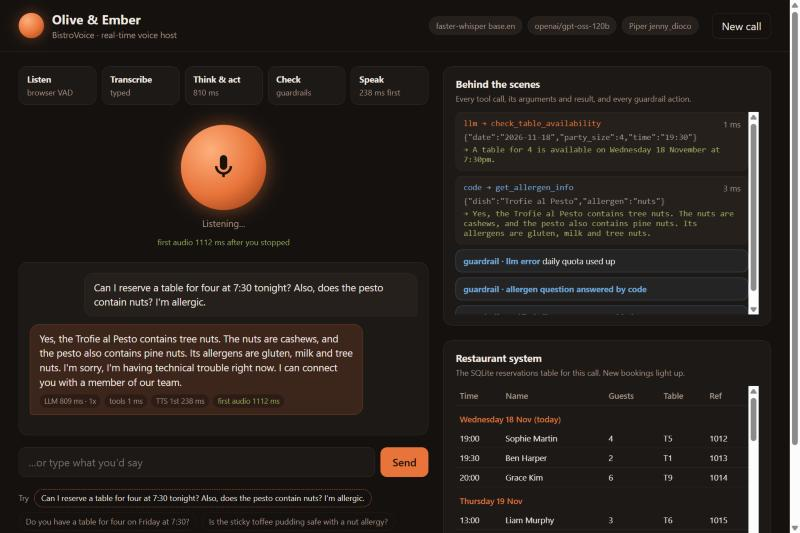
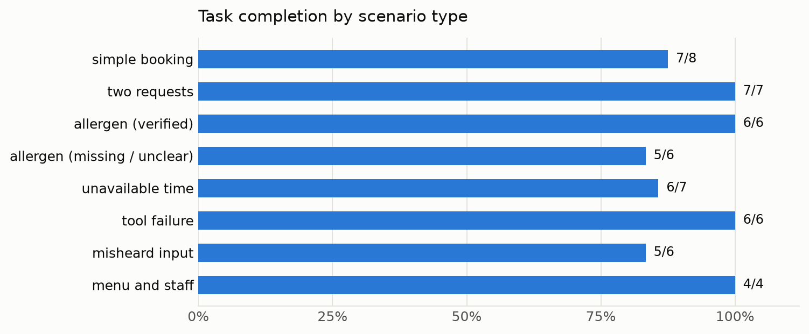
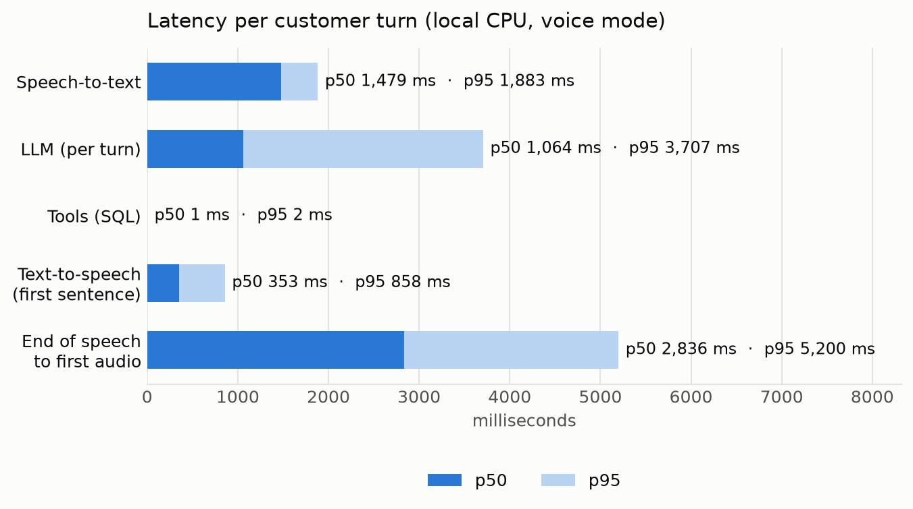
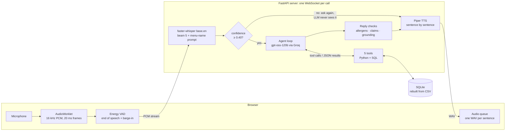
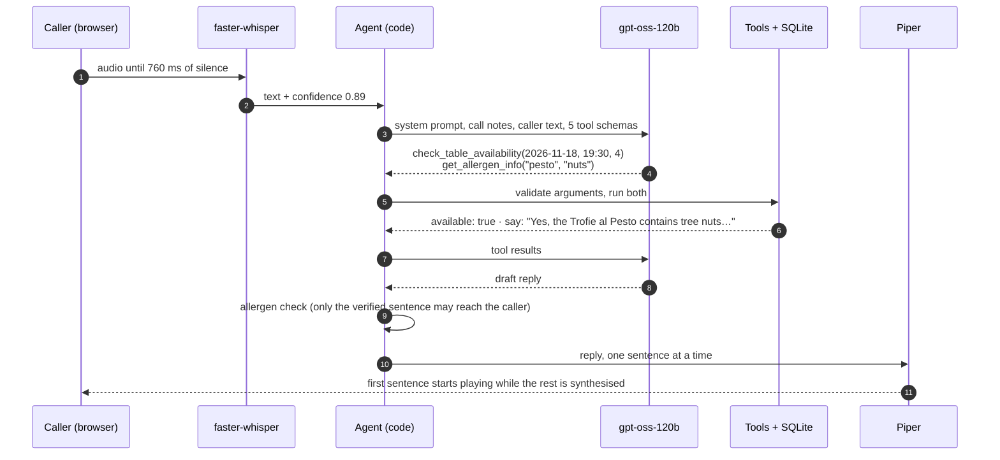

<div align="center">


<br>

**A voice agent for a restaurant that answers menu and allergen questions and books tables, in real time,
by calling tools. It never guesses an allergen and never books what the caller didn't confirm.**


-F55036)
-2E7D32)


[**Live demo**](https://bistrovoice.onrender.com/) · [**Demo video**](docs/demo/T01.mp4) · [Results](#results) · [Architecture](#architecture) ·
[Does every part need an LLM?](#does-every-part-of-the-problem-need-an-llm) · [Run it](#run-it-yourself)

</div>

---

## The 20-second version

A caller says:

> *"Can I reserve a table for four people at 7:30 tonight? Also, does the pesto contain nuts? I'm allergic."*

BistroVoice hears it with **faster-whisper**, lets **gpt-oss-120b** split it into two tool calls, answers the
allergen part **word for word from the verified allergen field**, checks the table in **SQLite**, reads the
booking back, books it only after a clear *yes*, and speaks every reply with **Piper**. All of it runs locally
or on free tiers.

<!-- t01:start -->
> 🧑 **Caller:** Can I reserve a table for four people at 7:30 tonight? Also, does the pesto contain nuts? I'm allergic.  
> <sub>heard as: “Can I reserve a table for four people at 730 tonight? Also, does the Pesto contain nuts? I'm allergic.” (confidence 0.893)</sub>  
> <sub>🔧 LLM → `get_allergen_info(allergen='nuts', dish='Pesto')` → **verified**</sub>  
> <sub>🔧 LLM → `check_table_availability(date='2026-11-18', party_size=4, time='19:30')` → **available**</sub>  
> <sub>🛡️ verified allergen sentence added</sub>  
> 🤖 **BistroVoice:** Yes, the Trofie al Pesto contains tree nuts. The nuts are cashews, and the pesto also contains pine nuts. Its allergens are gluten, milk and tree nuts. Great, we have a table for four at 7:30 pm tonight. May I have your name and a contact phone number, please?
>
> 🧑 **Caller:** Lucy Brennan, 07700 900211.  
> <sub>🔧 LLM → `create_reservation(date='2026-11-18', name='Lucy Brennan', party_size=4, phone='07700900211', time='19:30')` → **needs_confirmation**</sub>  
> 🤖 **BistroVoice:** Just to confirm: a table for 4 on Wednesday 18 November at 7:30pm, under the name Lucy Brennan, phone 07700 900211. Shall I book that?
>
> 🧑 **Caller:** Yes, please book it.  
> <sub>🔧 code → `create_reservation(name='Lucy Brennan', phone='07700900211', party_size=4, date='2026-11-18', time='19:30')` → **booked**</sub>  
> <sub>🛡️ confirmed by code</sub>  
> 🤖 **BistroVoice:** You're booked: a table for 4 on Wednesday 18 November at 7:30pm under the name Lucy Brennan. Your reference number is 1028.
>
> <sub>📒 reservations table: #1028 Lucy Brennan, 4 people, 2026-11-18 19:30, table T6</sub>
<!-- t01:end -->



<sub>The web app during a real call (typed rather than spoken here). The LLM checked the table, then Groq's free
daily quota ran out mid-turn. Code still answered the allergy question from the verified field and the caller
got an honest apology, not a fake booking. Left: the conversation with per-stage timings. Right: every tool
call and guardrail action, and the restaurant's reservations table.</sub>

What makes it more than a chatbot:

- **It acts.** Five tools read and write a real SQLite database. Bookings are real rows with a reference number.
- **The model proposes, code decides.** Dates, opening hours, party size, phone numbers, availability, the
  allergen answer, the read-back and the "yes" check are all plain code. The LLM can't book on its own say-so.
- **It fails honestly.** If a tool or the LLM is down, the caller hears an apology and an offer of a human,
  never a fake confirmation.
- **It is measured.** 50 scripted calls are run end to end as *audio*: a synthetic caller speaks, Whisper
  transcribes, the agent acts, Piper answers. Every number below comes from that run.

## Results

<!-- results:start -->
| | Metric | Result |
|---|---|---|
| ✅ | **Task completion** (the caller got what they asked for, checked in the database) | **88%** of 50 calls |
| 🛠️ | **Tool-calling accuracy**: right tool / right tool *and* arguments | **88%** / **88%** of 61 expected calls |
| 🙋 | **Handoff accuracy** (handed off when needed, and only then) | **98%** (precision 86%, recall 100%) |
| 🥜 | **Made-up allergen answers heard by a caller** (target 0) | **0** · correct allergen answers 18/19 |
| 📒 | **Wrong bookings** (a row written with details the caller didn't ask for) | **0** |
| 🚫 | Unwanted actions (a booking or handoff that shouldn't happen) | **1** |
| ⏱️ | **End of speech → first audio** | p50 **2.8 s** · p95 5.2 s |

<sub>Voice mode: every caller line is spoken by a Piper voice and transcribed by faster-whisper on a laptop
CPU, so speech recognition errors count against the agent. LLM: `openai/gpt-oss-120b` on Groq's free tier.
123 caller turns, 6 of them repeats after the agent asked again.</sub>

<picture><source media="(prefers-color-scheme: dark)" srcset="docs/img/completion-dark.png"></picture>

<picture><source media="(prefers-color-scheme: dark)" srcset="docs/img/latency-dark.png"></picture>
<!-- results:end -->

## Architecture



One customer turn, for the example above:



**Why this shape**

| Decision | Why | What I measured |
|---|---|---|
| Tools are plain Python + SQL, the LLM only calls them | Availability, opening hours and allergens have exact answers. An LLM can only make them worse. | 0 made-up allergen answers reached a caller (see results) |
| **gpt-oss-120b on Groq's free tier** | Free API key, ~1 s per call, solid tool calling, and Groq's prompt cache doesn't count cached tokens against the free quota | Pilot on the same 6 calls: 20b invented a name and phone number, qwen3.8-27b failed 2 of its first 4, 120b passed 5/6 (its failure, a double read-back, led to change #2 below) |
| **faster-whisper base.en**, beam 5, dish names and allergy words as the prompt | Runs on a laptop CPU in 1-1.5 s per caller turn | tiny.en kept only 19/28 key facts, small.en was 2.5x slower and kept fewer ([benchmark](#speech-to-text-model-choice)) |
| **Piper** (`en_GB-jenny_dioco`) | Local and free | First sentence ready in 0.24 s (p50), 0.68 s (p95) on the laptop CPU |
| Stream TTS by sentence, but *not* stream LLM tokens into TTS | The allergen check needs the whole reply before anything is spoken. A 2-sentence reply takes ~1 s from Groq, so the safety is cheap | |
| VAD in the browser | Endpointing and barge-in must react in milliseconds, without a network round trip | |
| A fresh in-memory copy of the database per call | Visitors to the hosted demo can't fill up each other's Friday night | |
| No agent framework | One loop of ~60 lines. Every rule is visible and testable, which matters more than features here | |

## Does every part of the problem need an LLM?

No. Out of the 18 jobs in a call, **four** use the LLM: understanding what the caller wants, splitting two
requests apart, choosing tools with arguments, and phrasing the reply. Everything with a single right answer is
code or SQL, and code checks the LLM's work before it reaches the caller.

| Job | Done by | Why not the other way |
|---|---|---|
| Speech to text | faster-whisper (a speech model, not an LLM) | |
| Is the transcript trustworthy? | **Code**: Whisper confidence < 0.40 → "could you say that again?" | An LLM would happily "understand" noise |
| What does the caller want? Two requests in one sentence? | **LLM** | Open-ended language |
| Which tool, with which arguments | **LLM** | |
| "tonight", "next Tuesday" → a date | **LLM**, reading a calendar that **code** writes into the prompt, and **code** checks the result against the weekday the caller said | Code supplies the facts, the LLM matches words to them. It still once turned "Tuesday" into a Monday, so code double-checks |
| Is the date in the past, the day closed, the time outside hours, on the 15-minute grid? | **Code** (`validation.py`) | Fixed rules |
| Party size 1-8, more goes to staff | **Code** | |
| Is a table free? Which one? | **SQL** (overlap query, smallest table that fits, ≤ 2 empty seats) | Exact |
| Nearest free times if not | **Code** (scan the day's 15-minute slots) | |
| Is this allergen record verified? | **Code**: `verified = yes` and every item is one of the 14 UK allergens | "nuts?" is not verified |
| The allergen sentence itself | **Code template** from the verified field | Must be exact |
| Was the name/phone actually said by the caller? | **Code** | The LLM once invented "John Smith" |
| Booking read-back and receipt | **Code template** | Must be exact, and saves an LLM call |
| Did the caller say yes? | **Code**: a short clear yes ("yes please", no "but"/"change"/"wait") books the held details directly, with no LLM call. Anything longer goes to the LLM, and code still checks it | The model once garbled the details when re-typing them |
| Writing the booking | **SQL transaction** (`BEGIN IMMEDIATE`, idempotent retry) | No double booking |
| Phrasing everything else | **LLM** | |
| Checking the reply before it's spoken | **Code** (allergen sentences, skipped allergy questions, booking/handoff claims, apology on failure) | |
| Text to speech | Piper | |

## The five tools

All five are plain functions in [`tools.py`](src/bistrovoice/tools.py). The JSON schemas the LLM sees are in
[`schemas.py`](src/bistrovoice/schemas.py). Every call goes through one executor (`run_tool`) that checks
required arguments, catches every exception and **never raises**: a failure comes back as
`{"ok": false, "error": "system_unavailable"}` and is never reported as success.

| Tool | Arguments | Returns | Checks in code |
|---|---|---|---|
| `check_table_availability` | `date`, `time`, `party_size` | `available`, or the 3 nearest free times (same day, else the next open days) | past date · closed day · outside hours / after last seating · 15-min grid · 30 min notice · 60 days ahead · 1-8 people (9+ → staff) |
| `search_menu` | `query` | up to 6 dishes: price, description, ingredients | course synonyms ("puddings" → desserts), fuzzy names ("tiramisoo") |
| `get_allergen_info` | `dish`, optional `allergen` | `status` verified/unconfirmed and a ready-made `say` sentence | dish must resolve to exactly one dish ("salad" → which one?) · unverified rows return **no** allergen data at all |
| `create_reservation` | `name`, `phone`, `party_size`, `date`, `time` | 1st call: `needs_confirmation`. After a yes: `booked` + reference | everything above again, plus UK phone format, name, "was it said?", no double booking, idempotent retries |
| `handoff_to_staff` | `reason` | ticket number | logged in the `handoffs` table |

## The allergen guardrail

The rule from the brief, *"allergen answers must come only from the verified field"*, is enforced in three
layers, so it doesn't depend on the model behaving:

1. **The data.** A record counts as verified only if the spreadsheet says `verified = yes` and every allergen
   is one of the 14 the UK requires restaurants to declare. Three dishes are deliberately broken:
   Soup of the Day (blank), Lamb Tagine (`sesame?;peanuts?`, waiting for a supplier's spec sheet) and Sticky
   Toffee Pudding (`nuts?`, pending). For those, the tool returns *no allergen data at all*, only
   *"I can't confirm the allergens in the Sticky Toffee Pudding right now, so I won't guess. I can connect you
   with a member of our team who can check."*
2. **The sentence.** For verified dishes the tool builds the answer itself:
   *"Yes, the Trofie al Pesto contains tree nuts. The nuts are cashews, and the pesto also contains pine nuts."*
   "Nuts" from a caller checks both tree nuts and peanuts; "shellfish" checks crustaceans and molluscs.
3. **The reply check.** Before anything is spoken, every sentence of the model's reply that talks about
   allergens is compared with the verified sentences. Anything else is removed and replaced with the verified
   text. If the model talked about allergens *without* calling the tool, code calls it for the dishes mentioned.
   And if the caller asked an allergy question that the model simply skipped, code looks it up and the verified
   answer is spoken anyway.
   The ingredient list never counts: the Sticky Toffee Pudding's ingredients contain no nuts, which is exactly
   why "it has no nuts" would be a dangerous made-up answer.

The evaluation scores this with a separate checker ([`eval/checks.py`](eval/checks.py)), deliberately not
sharing code with the guardrail, so a bug in one can't hide in the other.

## How each failure case is handled

| Failure | What the caller experiences | How | Tested by |
|---|---|---|---|
| **Caller interrupts** | The agent stops mid-word | The browser stops playback at once and sends `interrupt` with the number of sentences heard in full. The server cancels the turn. The history records only what was heard. **An interrupted booking read-back no longer counts**: a "yes" afterwards gets a fresh read-back | [`scripts/call_simulator.py`](scripts/call_simulator.py): streams spoken audio over the WebSocket, talks over the read-back, then says "yes" → read back again, not booked; "yes" to the heard read-back → booked. Passes on the final code locally and on the live Render deployment · unit tests |
| **Misheard input** | "Sorry, I didn't quite catch that" or a short question | Whisper confidence below 0.40 never reaches the LLM. Confident-but-odd text ("a cable for bore") → the LLM is told to ask, not guess. Wrong numbers fail validation (a 14-digit phone). A weekday that doesn't match the date is sent back. Wrong-but-valid details are caught by the read-back. Names/phones the caller never said are refused | M01-M06 |
| **Time unavailable** | "We don't have four at 7:30pm, but we do at 9pm, 9:15pm or 5:30pm" | Code scans the day for the nearest free 15-minute slots, then the next open days. Closed days and times after last seating also get bookable suggestions | U01-U07 |
| **Tool or database failure** | An apology and an offer of a person, never "you're booked" | The executor turns any exception into `system_unavailable`. The reply check removes booking/handoff claims that didn't happen and adds an apology if missing. If the handoff itself fails, the caller gets the restaurant's number. If the LLM is down, code answers with a fixed apology. A malformed tool call is not an outage: it is re-sampled, then the caller is asked to repeat | F01-F06 |
| **Rate limits on the free tier** | A short delay, or an apology after 3 s on a live call | 429s are retried using the server's `retry-after` and kept out of the latency numbers | |

<!-- samples:start -->
## Sample conversations

Real transcripts from the evaluation run: what the caller said, what Whisper heard, every tool call, every guardrail action. [Watch the brief's example as a video](docs/demo/T01.mp4) or listen to the [audio](docs/demo/T01.mp3).

<details><summary><b>A09 · Allergen record that isn't verified → no guess, offer a person</b> (passed)</summary>

> 🧑 **Caller:** Does the sticky toffee pudding have nuts? I'm allergic.  
> <sub>heard as: “Does the sticky toffee pudding have nuts and allergic?” (confidence 0.822)</sub>  
> <sub>🔧 LLM → `get_allergen_info(allergen='nuts', dish='sticky toffee pudding')` → **unconfirmed**</sub>  
> <sub>🛡️ verified allergen sentence added</sub>  
> 🤖 **BistroVoice:** I'm sorry, I can't confirm the allergens in the Sticky Toffee Pudding right now, so I won't guess. I can connect you with a member of our team who can check.
>
> 🧑 **Caller:** Yes please, put me through to someone.  
> <sub>heard as: “Yes please put me through to someone.” (confidence 0.907)</sub>  
> <sub>🔧 LLM → `handoff_to_staff(reason='Allergen inquiry for Sticky Toffee Pudding')` → **handed_off**</sub>  
> 🤖 **BistroVoice:** I've passed you to a member of our team, and they'll be with you shortly.

</details>

<details><summary><b>U01 · Requested time is full → nearest free times → booked</b> (passed)</summary>

> 🧑 **Caller:** Have you got a table for four on Friday at 7:30?  
> <sub>heard as: “Have you got a table for 4 on Friday at 7.30.” (confidence 0.841)</sub>  
> <sub>🔧 LLM → `check_table_availability(date='2026-11-20', party_size=4, time='19:30')` → **not available**</sub>  
> 🤖 **BistroVoice:** I'm sorry, we don't have a table for four at 7:30 pm on Friday. The nearest free times are 5:30 pm, 9:00 pm, or 9:15 pm. Which would you prefer?
>
> 🧑 **Caller:** 9pm is fine.  
> <sub>🔧 LLM → `create_reservation(date='2026-11-20', name='', party_size=4, phone='', time='21:00')` → **invalid_name**</sub>  
> 🤖 **BistroVoice:** May I have the name for the reservation, please?
>
> 🧑 **Caller:** Tom Baker, 07700 900231.  
> <sub>heard as: “Tom Bacon 07700900231” (confidence 0.719)</sub>  
> <sub>🔧 LLM → `create_reservation(date='2026-11-20', name='Tom Bacon', party_size=4, phone='07700900231', time='21:00')` → **needs_confirmation**</sub>  
> 🤖 **BistroVoice:** Just to confirm: a table for 4 on Friday 20 November at 9pm, under the name Tom Bacon, phone 07700 900231. Shall I book that?
>
> 🧑 **Caller:** Yes please.  
> <sub>🔧 code → `create_reservation(name='Tom Bacon', phone='07700900231', party_size=4, date='2026-11-20', time='21:00')` → **booked**</sub>  
> <sub>🛡️ confirmed by code</sub>  
> 🤖 **BistroVoice:** You're booked: a table for 4 on Friday 20 November at 9pm under the name Tom Bacon. Your reference number is 1028.
>
> <sub>📒 reservations table: #1028 Tom Bacon, 4 people, 2026-11-20 21:00, table T5</sub>

</details>

<details><summary><b>M05 · Wrong day caught at the read-back → corrected → booked</b> (passed)</summary>

> 🧑 **Caller:** Table for two on Thursday at 1pm, Joe Tan, 07700 900255.  
> <sub>heard as: “Table for 2 on Thursday at 1pm, Jotan, 07700, 900255.” (confidence 0.86)</sub>  
> <sub>🔧 LLM → `check_table_availability(date='2026-11-20', party_size=2, time='13:00')` → **available**</sub>  
> <sub>🔧 LLM → `create_reservation(date='2026-11-20', name='Joe Tan', party_size=2, phone='07700900255', time='13:00')` → **needs_confirmation**</sub>  
> 🤖 **BistroVoice:** Just to confirm: a table for 2 on Friday 20 November at 1pm, under the name Joe Tan, phone 07700 900255. Shall I book that?
>
> 🧑 **Caller:** No, I said Thursday, not Friday.  
> <sub>🔧 LLM → `check_table_availability(date='2026-11-19', party_size=2, time='13:00')` → **available**</sub>  
> 🤖 **BistroVoice:** Great, a table for 2 on Thursday 19 November at 1pm is free. Shall I go ahead and book it for Joe Tan, phone 07700 900255?
>
> 🧑 **Caller:** Yes, that's right.  
> <sub>🔧 LLM → `create_reservation(date='2026-11-19', name='Joe Tan', party_size=2, phone='07700900255', time='13:00')` → **booked**</sub>  
> 🤖 **BistroVoice:** You're booked: a table for 2 on Thursday 19 November at 1pm under the name Joe Tan. Your reference number is 1028.
>
> <sub>📒 reservations table: #1028 Joe Tan, 2 people, 2026-11-19 13:00, table T1</sub>

</details>

<details><summary><b>F05 · Handoff system down → the restaurant's number, not a fake transfer</b> (passed)</summary>

> 🧑 **Caller:** Can I speak to a manager please?  
> <sub>🔧 LLM → `handoff_to_staff(reason='caller wants to speak to manager')` → **system_unavailable**</sub>  
> 🤖 **BistroVoice:** I'm sorry, I can't put you through right now. Please call us directly on 020 7946 0321.

</details>
<!-- samples:end -->

## Data

Everything is fictional and made by me for this project, in plain CSV so anyone can edit it in a spreadsheet:
[`data/`](data). `bistrovoice init-db` rebuilds SQLite from it and refuses broken references.

| File | Rows | Notes |
|---|---|---|
| `menu.csv` | 20 dishes | dish, description, price, category |
| `ingredients.csv` | 81 | one row per ingredient, for menu questions only, *never* for allergens |
| `allergens.csv` | 20 | `contains` uses the 14 UK allergens. **3 rows deliberately missing or unclear** |
| `opening_hours.csv` | 12 | split lunch/dinner service, last seating, closed Mondays |
| `tables.csv` | 11 tables | 2 to 8 seats |
| `reservations.csv` | 27 | Friday dinner deliberately full, to test unavailable times. Phone numbers are from Ofcom's range reserved for drama (07700 900xxx) |
| `restaurant.csv` | settings | booking length 120 min, max online party 8, kitchen cross-contact note |

## Evaluation

<!-- eval:start -->
**How it works.** [`eval/scenarios.yaml`](eval/scenarios.yaml) holds 50 scripted calls (B simple
bookings, T two requests in one turn, A allergens (verified, missing, unclear), U unavailable times, F tool and LLM
failures, M misheard input, G menu and staff). Each call starts from a fresh copy of the CSV data with the clock
frozen at Wednesday 18 November 2026, 15:00. In voice mode each caller line is spoken by one of two Piper caller
voices (US and northern English), transcribed by faster-whisper, answered by the agent and spoken back with Piper.
Misheard input is simulated by replacing the transcript (`heard:`) with a low or misleading confidence. Tool
failures are injected per call. If the agent asks the caller to say something again, the caller repeats the line
once, more slowly.

**How it is scored** ([`run_eval.py`](eval/run_eval.py), [`checks.py`](eval/checks.py))

| Metric | Definition |
|---|---|
| Task completion | every check of the call passes: the right row in `reservations` (or none), reference number given, allergen answers right, expected replies, handoff decision, nothing acted on in a "doubtful" turn |
| Tool selection / arguments | for each expected call, did the LLM make a call with that name / with matching arguments (dates, times, phones and dish names normalised) |
| Handoff accuracy | `handoff_to_staff` called exactly in the calls that need it |
| Made-up allergen answers | sentences that state an allergen is present or absent when the verified field says otherwise or can't be confirmed, scored by a checker that shares no code with the guardrail |
| Latency | per caller turn; LLM time excludes waiting on the free tier's rate limit |

**By category**

| Category | Passed |
|---|---|
| simple booking | 6/8 |
| two requests | 5/7 |
| allergen (verified) | 6/6 |
| allergen (missing / unclear) | 6/6 |
| unavailable time | 6/7 |
| tool failure | 5/6 |
| misheard input | 6/6 |
| menu and staff | 4/4 |

**Latency per caller turn (ms)**, laptop CPU (Intel Core Ultra 7 155U, no GPU)

| Stage | p50 | p95 |
|---|---|---|
| Speech-to-text (faster-whisper base.en) | 1,479 | 1,883 |
| LLM, all calls in the turn | 1,064 | 3,707 |
| Tools (Python + SQLite) | 1 | 2 |
| Text-to-speech, first sentence (Piper) | 353 | 858 |
| **End of caller's speech → first audio** | 2,836 | 5,200 |

"First audio" is measured from the end of the caller's audio: in the browser add the 760 ms of silence the
VAD waits for before deciding the caller has finished. LLM calls per turn: 1.26
(read-backs, receipts and confirmations are code, so many turns need one call or none).

**What the guardrails did** during the run

| Event | Count |
|---|---|
| `templated_reply` | 26 |
| `confirmed_by_code` | 18 |
| `verified_allergen_sentence_added` | 8 |
| `duplicate_removed` | 7 |
| `asr_low_confidence` | 3 |
| `allergen_question_answered_by_code` | 2 |
| `allergen_sentence_removed` | 1 |
| `handoff_requested_by_caller` | 1 |
| `llm_error` | 1 |
| `malformed_tool_call` | 1 |

<details><summary><b>All 50 scenarios</b></summary>

| ID | Category | Scenario | Result | Failed checks |
|---|---|---|---|---|
| B01 | simple booking | Two people tomorrow at 8pm | ✅ |  |
| B02 | simple booking | Everything in one sentence | ✅ |  |
| B03 | simple booking | Six people, "half seven" | ✅ |  |
| B04 | simple booking | Table for one tonight | ✅ |  |
| B05 | simple booking | Sunday lunch for four | ✅ |  |
| B06 | simple booking | Next Tuesday | ✅ |  |
| B07 | simple booking | Details given one at a time | ❌ | booking_correct |
| B08 | simple booking | International phone format | ❌ | booking_correct |
| T01 | two requests | The brief's example: table + pesto nuts | ✅ |  |
| T02 | two requests | Booking + dessert menu | ✅ |  |
| T03 | two requests | Gluten question + booking | ✅ |  |
| T04 | two requests | Booking + eggs in tiramisu | ❌ | booking_correct, allergen:Tiramisu |
| T05 | two requests | Menu search + Monday opening | ✅ |  |
| T06 | two requests | Busy time + unconfirmed allergen | ❌ | booking_correct, handoff_decision, reply_any |
| T07 | two requests | Booking + shellfish in calamari | ✅ |  |
| A01 | allergen (verified) | Pesto and nuts | ✅ |  |
| A02 | allergen (verified) | Burrata and a nut allergy | ✅ |  |
| A03 | allergen (verified) | Sesame in the hummus | ✅ |  |
| A04 | allergen (verified) | Coeliac asking about sea bass | ✅ |  |
| A05 | allergen (verified) | Dairy in the lemon sorbet | ✅ |  |
| A06 | allergen (verified) | Egg in the chicken Milanese | ✅ |  |
| A07 | allergen (missing / unclear) | Soup of the day, missing record | ✅ |  |
| A08 | allergen (missing / unclear) | Lamb tagine, unclear record | ✅ |  |
| A09 | allergen (missing / unclear) | Pudding + nuts, accepts staff | ✅ |  |
| A10 | allergen (missing / unclear) | All allergens in the soup, accepts staff | ✅ |  |
| A11 | allergen (missing / unclear) | Unclear dish, then a verified one | ✅ |  |
| A12 | allergen (missing / unclear) | Which desserts are nut free? | ✅ |  |
| U01 | unavailable time | Busy Friday, takes 9pm | ✅ |  |
| U02 | unavailable time | Busy Friday, declines alternatives | ✅ |  |
| U03 | unavailable time | Closed on Monday | ❌ | booking_correct |
| U04 | unavailable time | After last seating | ✅ |  |
| U05 | unavailable time | Between lunch and dinner today | ✅ |  |
| U06 | unavailable time | Party of twelve goes to staff | ✅ |  |
| U07 | unavailable time | Date in the past | ✅ |  |
| F01 | tool failure | Booking database down, accepts staff | ❌ | reply_any |
| F02 | tool failure | Availability check down, declines staff | ✅ |  |
| F03 | tool failure | Allergen lookup down | ✅ |  |
| F04 | tool failure | Menu search down | ✅ |  |
| F05 | tool failure | Handoff itself fails | ✅ |  |
| F06 | tool failure | LLM provider down | ✅ |  |
| M01 | misheard input | Low-confidence transcript | ✅ |  |
| M02 | misheard input | Confident but garbled | ✅ |  |
| M03 | misheard input | Two heard as twenty-two | ✅ |  |
| M04 | misheard input | Phone number missing a digit | ✅ |  |
| M05 | misheard input | Wrong day caught at read-back | ✅ |  |
| M06 | misheard input | Noise, then a question | ✅ |  |
| G01 | menu and staff | Price question | ✅ |  |
| G02 | menu and staff | Dish not on the menu | ✅ |  |
| G03 | menu and staff | Sunday opening time | ✅ |  |
| G04 | menu and staff | Asks for a person | ✅ |  |

Full transcripts: [`eval/results/voice/scenarios.jsonl`](eval/results/voice/scenarios.jsonl) ·
`python scripts/show_run.py voice T01`
</details>
<!-- eval:end -->

## What failed, and what I changed

Each stage was tested before the next (the commit history follows the stages). These are the real problems
the tests and the evaluation found:

| # | What went wrong | How I found it | What I changed |
|---|---|---|---|
| 1 | **gpt-oss-20b invented booking details** ("John Smith", 07123456789) when the caller hadn't given any | model pilot, reading transcripts | `create_reservation` refuses a name or phone number the caller never said. Switched to gpt-oss-120b |
| 2 | **The model asked "shall I book it?" and then the tool read it back again**: a double confirmation | pilot transcripts | Read-back and receipt are written by code from the tool result, and a short clear "yes" is booked by code with no LLM call |
| 3 | On the confirmation turn the model **re-typed the details and garbled them** (`"party_size":1"`, a 7-digit phone): Groq rejected the call | voice eval, Groq's `failed_generation` | Same fix as 2: code holds the read-back details, so the model never re-types them |
| 4 | **It answered the booking half of the brief's own example and ignored "does the pesto contain nuts? I'm allergic"** | voice eval, scenario T01 | If the caller asks about allergens in a dish and no lookup happened, code looks it up and the verified answer is spoken anyway |
| 5 | The calendar in the prompt said "tomorrow 19 Nov" without the weekday, so **"Thursday" became Saturday** | voice eval, B02 | Every calendar entry keeps its weekday: `Thu 19 Nov (tomorrow) = 2026-11-19`. The code read-back would still have shown the caller the wrong day |
| 6 | **My own voice normaliser read "7:30" as 07:30**, so the synthetic caller literally said "seven thirty A M" | voice pilot: every 7:30 booking failed | Only unambiguous 24-hour times are converted. A unit test pins it |
| 7 | **Whisper took 3-7 s and Piper 2 s per call**, against ~1 s and ~0.2 s in the benchmark | latency numbers didn't match the benchmark | Windows 11 power throttling (EcoQoS) parks background processes on efficiency cores. The process now opts out (`speech.keep_full_cpu_speed`) |
| 8 | "LLM latency" of 13-20 s in the first pilot | p95 made no sense for a 1 s model | It was the free tier's 8K tokens/minute limit plus the SDK's silent retries. Rate-limit waits are now handled and reported separately from latency |
| 9 | **Phone numbers are where speech recognition fails**: phantom digits ("900, 200, 201"), merged groups | voice eval | Beam search 5 instead of greedy (phone lines right: 4/10 → 7/10), a phone-number example in Whisper's prompt (10/18 → 13/18), commas accepted, length validation rejects the rest, and the read-back catches what's left |
| 10 | The transcript-confidence gate (0.55) asked callers to repeat **perfectly transcribed** phone numbers | voice eval: "Kate Morris 07700900216" scored 0.51 | Calibrated on our audio: digit strings score 0.45-0.68, noise ~0.1. Gate set to 0.40 |
| 11 | **Only 10-28% of prompt tokens hit Groq's prompt cache** in the pilots: the time and booking state lived inside the system prompt and older turns were condensed, so every request started differently | `prompt_tokens_details.cached_tokens` | The system prompt is now the same all day, per-turn state goes in a short "call notes" message, and history is append-only, so each request starts with the previous one. **61% of prompt tokens came from cache in run 1**, and cached tokens don't count against the free quota |
| 12 | Model output contained narrow no-break spaces (`7:30 pm`), markdown and `"?........."` | eval transcripts | `tidy()` normalises the text before checks and speech |
| 13 | The allergen sentence was said twice (the model's own "I can't confirm…" plus the verified one) | pilot transcripts | Near-duplicates of the verified text are removed |
| 14 | "Fatima, Begum": a comma from the transcript made a valid name fail validation | voice eval, B03 | Commas in names are treated as spaces |
| 15 | The model's date arithmetic: **"Tuesday then" became 2026-11-23, a Monday** | run 1, U03 | Code compares the date with the weekday (or "tomorrow") the caller said and hands back the right date before any tool runs |
| 16 | **"Nut free" was heard as "not free"** twice, so the allergy question never reached the LLM | run 1, T06 and A12 | Allergy words in Whisper's prompt ("nut free, gluten free, dairy free…"). The benchmark with both lines added keeps 27/28 key facts |
| 17 | The model sent `allergen: ""` for "is there any dairy in the sorbet?", so the answer didn't say "no dairy" | run 1, A05 | Code fills the allergen in from the caller's words |
| 18 | The model narrated: **"User hasn't responded yet."** was spoken to a caller | run 1, U04 | Sentences about "the user" are never spoken |
| 19 | A malformed tool call was treated as an outage: the agent offered staff, and **the caller's next "yes" handed them over** | run 2, B01 | Malformed calls are re-sampled up to 3 times; if that fails, the caller is asked to repeat. Groq's `failed_generation` is logged |
| 20 | **My checker** scored "contains none of the 14 major allergens" as no answer | run 1, A05 | Fixed the checker and re-graded the saved transcripts (`run_eval.py --rescore`), no new LLM calls |
| 21 | **A wrong booking.** Read-back "Friday 1pm", caller: "No, I said Thursday". The model checked Thursday and asked its own question without a new read-back; the caller said "Yes" and code booked the *old* Friday read-back it was still holding | run 2, M05 (the wrong-bookings metric) | A read-back only counts while it is the last thing the caller heard; any later turn without a yes voids it |
| 22 | The model often read the booking back in its own words instead of calling the tool, so a "yes" led to a second, code-worded read-back | run 2/3, B01 | A model-written read-back counts if code finds every detail (name, phone, day, time, party size) in the reply the caller just heard; otherwise the code read-back is still required |
| 23 | The handoff tool failed and the agent offered… a member of staff | run 2, F05 | Code answers a failed handoff with the restaurant's phone number |
| 24 | The allergen lookup failed and the agent only said "I couldn't get that information" | run 2, F03 | Code makes the caller hear plainly that allergens can't be checked right now and nothing is guessed |
| 25 | "Yes, please put me through" was answered with another question about the phone number | run 2, F01 | An explicit request for a person is honoured by code if the model doesn't hand over |
| 26 | Fix 21 went too far: "Yes" misheard as "Bass," → "could you say that again?" → "Yeah" voided the read-back | U04 | A "say that again" exchange adds nothing new, so the read-back before it still counts |
| 27 | **My checker** didn't accept "I can't check allergen information right now, so I won't guess" because it doesn't name the dish | run 3, F03 | It now counts as a correct "can't confirm" answer; all three runs re-graded the same way (run 2's vaguer "I couldn't get that information" still fails) |

**Three runs.** Each run found problems that were fixed before the next one: run 1 stopped at call 31 when the
free daily quota ran out (fixes 15-20), run 2 covered all 50 calls (fixes 21-27 came from it and from early
run-3 attempts), and run 3 is the final code.
Each column is scored on that run's own calls:

<!-- compare:start -->
| | Run 1 (31 calls) | Run 2 (50 calls) | **Run 3, final** (50 calls) |
|---|---|---|---|
| Task completion | 77% | 88% | 88% |
| Tool selection | 93% | 93% | 88% |
| Tool arguments | 84% | 92% | 88% |
| Handoff accuracy | 100% | 98% | 98% |
| Made-up allergen answers heard | 0 | 0 | 0 |
| **Wrong bookings** | 0 | 1 | 0 |
| Caller had to repeat a line | 4 | 6 | 6 |
| First audio, p50 | 2.8 s | 2.9 s | 2.8 s |
<!-- compare:end -->

Task completion stops at 88% in runs 2 and 3, and the reason is the most useful finding of the project: the
fixes removed the failures they targeted (the wrong booking in M05, the failure paths F03 and F05), but which
calls Whisper mishears changes from run to run, and at 50 calls that variation is as large as the fixes. What
the fixes did move is safety: **run 2 wrote one wrong booking, run 3 none**, and no run ever let a made-up
allergen answer reach a caller.

**Every one of the six failures in run 3 starts with speech recognition:**

| Call | What Whisper heard | What the agent did |
|---|---|---|
| B07 | "half past twelve" → "Have past 12" | Asked for the exact time (right), but the scripted caller can't answer a question it doesn't expect |
| B08 | the "+44 7700 900208" part of the line was lost | Asked for the number; the scripted caller said "That's right" |
| T04 | "egg in it" → "agony" | Asked which allergen was meant (right), **but skipped the table request in the same sentence** |
| T06 | "four" → "for for", "9pm" → "9p" | **The model read "9p" as a party of nine** instead of asking; the scripted "Yes" then accepted a handoff (the run's one unwanted handoff) |
| U03 | the phone number lost a digit, twice | Refused the 10-digit number both times (right); the model's wrong date for "Tuesday" was caught by fix 15 on the way |
| F01 | the name and number were dropped from the first line | Asked for them, so the simulated outage was never reached; "put me through" was honoured (fix 25) |

**Known weaknesses:** speech recognition of names, numbers and short words on a laptop CPU; the model
occasionally handling only one of two requests (T04) or guessing from garbled text instead of asking (T06). A
human caller would correct most of these at the read-back; the scripted caller can't.

## Speech-to-text model choice

<!-- stt:start -->
[`eval/bench_stt.py`](eval/bench_stt.py): 14 typical caller lines spoken by two Piper voices
(28 clips), transcribed on the laptop CPU. "Key facts" means every number, time, name and dish that the agent
needs survived.

| Model | Word error rate | Key facts kept | p50 latency (ms) | Real-time factor |
|---|---|---|---|---|
| tiny.en + prompt, beam 1 | 10.8% | 19/28 | 312 | 0.15 |
| base.en, beam 1 | 11.7% | 22/28 | 728 | 0.37 |
| base.en + prompt, beam 1 | 8.5% | 27/28 | 825 | 0.40 |
| base.en + prompt, beam 5 | 8.8% | 27/28 | 1,016 | 0.51 |
| small.en + prompt, beam 1 | 6.2% | 26/28 | 2,468 | 1.23 |

The prompt (dish names, a phone-number example, allergy words) is the biggest win: 22 → 27 key facts for
base.en. Beam 5 keeps the same facts here, but on a separate set of phone-number lines it got 7/10 right against
4/10 for greedy decoding, which is worth ~0.2 s for a booking agent. small.en is 2.5x slower and no better.
Phone numbers stay the hardest part, see the build log below.
<!-- stt:end -->

## Run it yourself

Windows, macOS or Linux, Python 3.11, no GPU, no paid keys.

```bash
git clone https://github.com/sehscape/BistroVoice.git
cd BistroVoice
python -m venv .venv
.venv\Scripts\activate          # macOS/Linux: source .venv/bin/activate
pip install -e ".[dev]"
copy .env.example .env          # macOS/Linux: cp .env.example .env
```

Put a free Groq key (https://console.groq.com/keys, no card) after `GROQ_API_KEY=` in `.env`, then:

```bash
bistrovoice download-models     # Piper voices + Whisper base.en, ~330 MB
bistrovoice serve               # open http://127.0.0.1:8000 and click the orb
```

Other commands:

```bash
bistrovoice chat -v             # text mode in the terminal, shows tool calls and guardrail events
pytest                          # unit tests, no network needed
python eval/run_eval.py         # the 50-call evaluation (voice mode); --mode text skips audio
python scripts/call_simulator.py   # phones the running server, including a barge-in
```

Want it fully offline? Point `LLM_BASE_URL` at Ollama (`http://localhost:11434/v1`) with a tool-calling model.

## Free hosting

**Live: https://bistrovoice.onrender.com/** (free tier: the first visit after 15 idle minutes takes about a
minute to wake up, and replies are slower than on a laptop because the server gets a tenth of a CPU; measured after deploying:
first audio 1.5 s after a typed question).

[`render.yaml`](render.yaml) deploys the app to Render's free plan (Docker, no card): *New → Blueprint →* pick
this repo and paste the Groq key. A free instance has a tenth of a CPU, where local Whisper would take ~10 s
per sentence, so the hosted demo sets `STT_BACKEND=groq` (Whisper large-v3-turbo on the same free Groq key).
Piper still runs inside the container, on a single thread (`TTS_THREADS=1`): with ONNX Runtime's default
thread pool one sentence took 16 s there. The same setting turns off ONNX Runtime's memory arena: a live call
was dropped when memory peaked at 576 MB, over the free tier's 512 MB; it now peaks at about 306 MB. Locally and in the evaluation, speech-to-text is always faster-whisper.
The free instance sleeps after 15 minutes idle; the first visit wakes it in about a minute.

## Project layout

```
data/                    the restaurant, as CSV (source of truth)
src/bistrovoice/
  db.py                  schema, CSV loader with checks, booking rules
  validation.py          dates, times, hours, party size, phone, name: no LLM
  tools.py               the 5 tools + safe executor
  allergens.py           14-allergen vocabulary, "verified" rule, answer sentences
  schemas.py             tool definitions sent to the LLM
  agent.py               the loop: LLM ↔ tools, confirmation step, grounding, templates
  guardrails.py          checks on every reply before it is spoken
  llm.py                 OpenAI-compatible client, rate-limit handling, eval cache
  speech.py              faster-whisper, Piper, text normalisation for the voice
  server.py              FastAPI + WebSocket, barge-in, per-call database
  web/                   the browser client (no framework, no build step)
eval/
  scenarios.yaml         the 50 scripted calls
  run_eval.py            runs them as audio and scores them
  checks.py              independent scoring (allergen claims, tool-call matching)
  bench_stt.py           Whisper size benchmark
  results/               the numbers in this README
scripts/                 call simulator (barge-in test), demo video maker
tests/                   86 unit tests, including the agent with a scripted fake LLM
```

## Limitations and next steps

- **Phone numbers are the weakest link of local speech-to-text.** base.en misreads some numbers.
  Validation and the read-back stop a wrong number being booked, but the caller sometimes has to repeat
  it. A phone deployment would collect the caller ID instead of asking.
- Scripted callers don't improvise. Apart from repeating a line when asked, they follow the script, so a
  natural but unexpected reply from the agent can fail a scenario that a human caller would complete.
- Energy-based VAD is simple and fast but can be fooled by loud background noise. A small neural VAD (Silero)
  would be the next step.
- Real phone calls (Twilio Media Streams → the same WebSocket) are the obvious extension. The server already
  speaks 16 kHz PCM, so it mainly needs μ-law conversion.
- The evaluation runs on Groq's free tier (200K tokens a day per model), so a full 50-call run can span two
  days. `python eval/run_eval.py` picks up where it stopped, and cached replies make reruns free.

## License

MIT. The restaurant, its menu, people and phone numbers are fictional.
